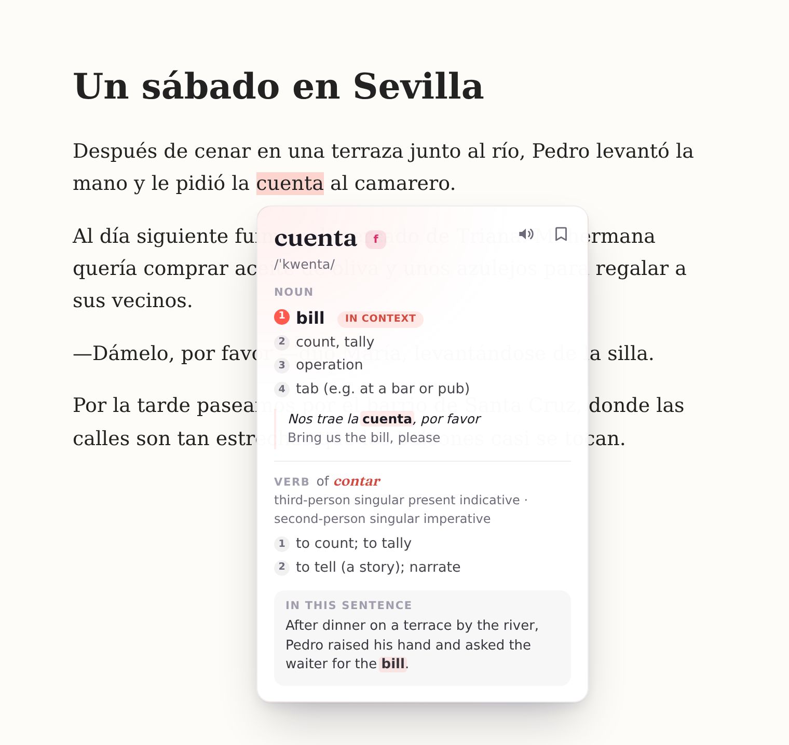
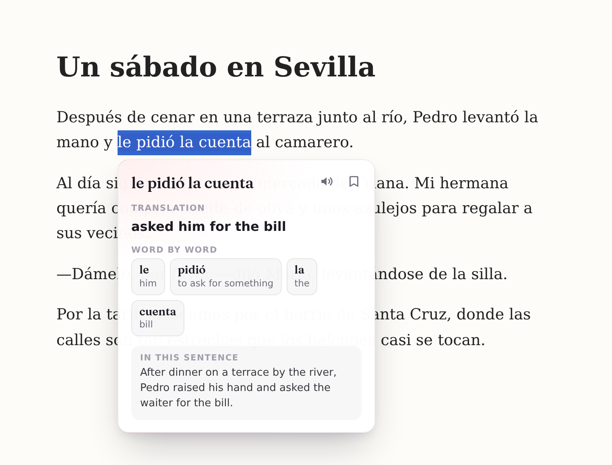
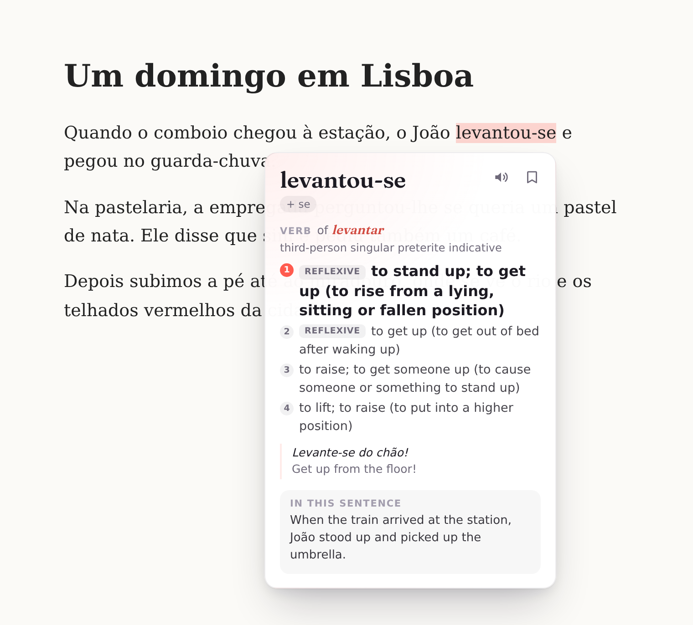
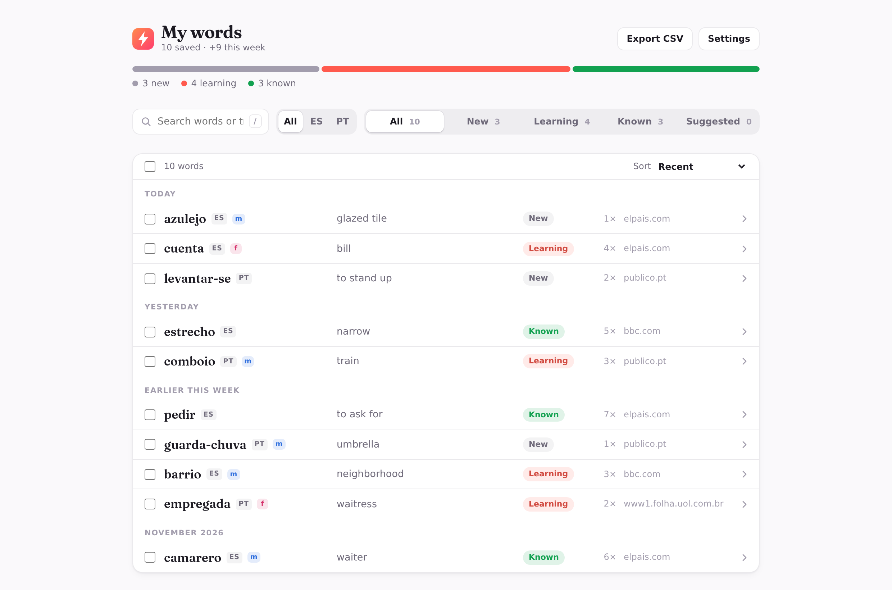
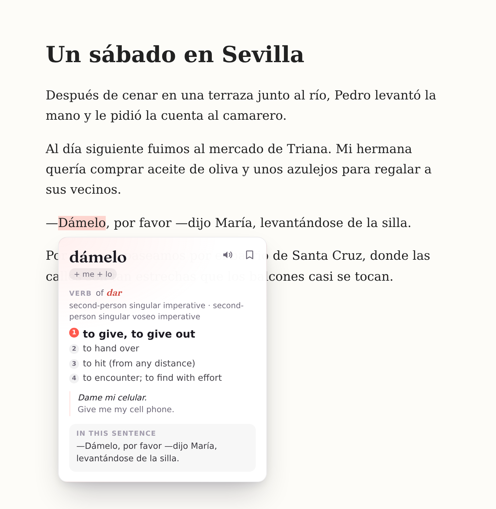
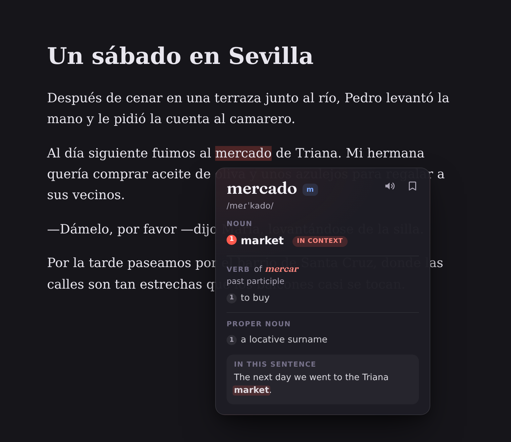
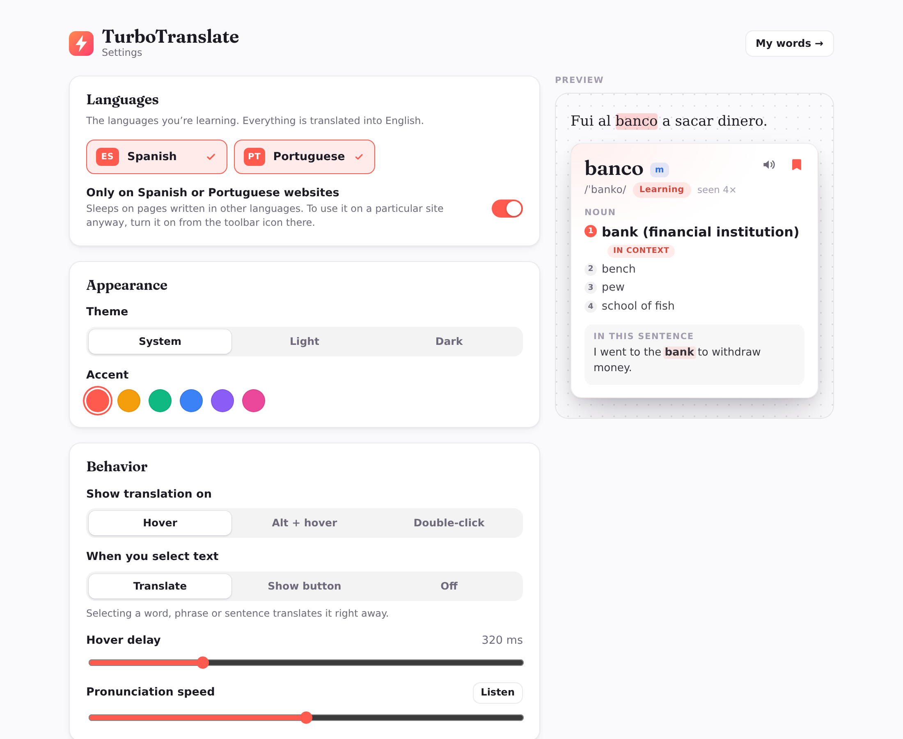

# TurboTranslate

[](https://github.com/bartczyz/turbo-translate/actions/workflows/ci.yml)
[](https://github.com/bartczyz/turbo-translate/releases/latest)

**Hover over a Spanish or Portuguese word to see what it means in that sentence.**

TurboTranslate is a browser extension for Chrome and Firefox, for language learners who read real websites: news, Wikipedia, recipes, forums.
Rest the pointer on a word and a card shows its meaning, grammar and pronunciation.
It picks the sense that fits the sentence you're reading, and the dictionary works offline.

<p align="center">
  
</p>

## Features

- **Instant word cards.** Each card shows meanings, gender, IPA, example sentences, and an audio button for pronunciation.
  Conjugated verbs link back to their infinitive (*hablaba* → **hablar**).
- **Meaning in context.** The extension translates the surrounding sentence on your device and marks the sense that matches (Chrome only, see [Browser support](#browser-support)).
  *cuenta* is "bill" at a restaurant and "account" on a login page.
  For short labels like a lone "Cuenta" button, it looks for the same word elsewhere on the page.
- **Selections.** Select a phrase or a whole paragraph to get a translation.
  Short phrases also get a word-by-word breakdown.
- **Attached pronouns understood.** *dámelo* → **dar** + me + lo, *levantándose* → reflexive "to get up".
  In Portuguese: *levantou-se*, *fazê-lo* → **fazer**, *dar-te-ei* → **dar**.
  Hyphenated words like *guarda-chuva* are treated as one word.
- **Only where it's useful.** It detects each page's language from its text, not just the `lang` tag, and sleeps on pages in other languages.
  The toolbar shows **ES** or **PT** where it's active. You can force a site on or off from the popup.
- **My words.** Bookmark a word to save it. Each saved word keeps every sentence you met it in, with a link back to the page.
  Mark words as New, Learning or Known. Search, sort, apply bulk actions, or export to CSV.
  Words you keep looking up but haven't saved are suggested.
- **AI explanations (optional).** Add your own Claude, OpenAI or Gemini API key, and an AI explains what a word means in that exact sentence.
- **Looks good everywhere.** Light and dark themes, six accent colors.
  The card renders in a shadow DOM, so page styles can't break it.

| Selections | Portuguese | My words |
|---|---|---|
|  |  |  |

| Attached pronouns | Dark theme | Settings |
|---|---|---|
|  |  |  |

## Privacy

TurboTranslate has no server, no account and no analytics.

- **Dictionary:** lookups read files bundled with the extension. Nothing is sent anywhere.
- **Sentence translation:** uses Chrome's built-in [Translator API](https://developer.chrome.com/docs/ai/translator-api). The model runs on your device.
- **Saved words:** stored in your browser's IndexedDB.
- **Settings:** synced through your browser profile.
- **API keys:** stored only on this device and never synced.
- **AI explanations:** when you click **Explain in context**, the word, its sentence and a few nearby sentences go to the provider whose key you added: Anthropic, OpenAI or Google.
  Nothing is sent while this feature is off, which is the default.

## Install

TurboTranslate isn't in the Chrome Web Store or on addons.mozilla.org yet. Install it from the [latest release](https://github.com/bartczyz/turbo-translate/releases/latest).

### Chrome (and Edge, Brave, other Chromium browsers)

1. Download `turbotranslate-<version>-chrome.zip` and unzip it.
2. Open `chrome://extensions` and turn on **Developer mode** (top right).
3. Click **Load unpacked** and pick the unzipped folder. Keep the folder: Chrome loads the extension from it.

To update, unzip the new release over the same folder and click the reload icon on TurboTranslate's card in `chrome://extensions`.
Your saved words and settings are kept.

### Firefox (140 or newer)

- **Signed build:** if the release has a `turbotranslate-<version>-firefox.xpi`, open it in Firefox and confirm.
  It installs permanently and keeps your words across updates.
- **Otherwise:** download `turbotranslate-<version>-firefox.zip` and open `about:debugging#/runtime/this-firefox`.
  Click **Load Temporary Add-on** and pick the zip.
  Firefox removes temporary add-ons when it restarts, so this suits trying it out.

### Browser support

| | Chrome 138+ | Firefox 140+ |
|---|---|---|
| Word cards, offline dictionary, attached pronouns | ✓ | ✓ |
| Selections with word-by-word breakdown | ✓ | ✓ |
| My words, page-language detection, pronunciation | ✓ | ✓ |
| AI explanations (your own key) | ✓ | ✓ |
| On-device sentence translation and meaning in context | ✓ | — |

Sentence translation uses Chrome's built-in [Translator API](https://developer.chrome.com/docs/ai/translator-api), which Firefox doesn't offer to extensions.
In Firefox, cards list the senses in dictionary order. Add an AI key to get explanations in context and whole-phrase translations.
If Firefox adds the API later, TurboTranslate picks it up without changes.

### Build from source

```bash
git clone https://github.com/bartczyz/turbo-translate.git && cd turbo-translate
pnpm install
pnpm build:dict   # downloads and builds the offline dictionaries, takes 1–2 minutes
pnpm build        # outputs .output/chrome-mv3 (pnpm build:firefox → .output/firefox-mv3)
```

`build:dict` streams the Wiktionary data from [kaikki.org](https://kaikki.org): about 1 GB for Spanish and 600 MB for Portuguese.
It keeps only the compact dictionaries it builds (about 65 MB in `public/dict`).
Load the output folder as above (in Firefox, pick its `manifest.json` in **Load Temporary Add-on**).

After installing:

- **Languages:** Spanish is on by default. Turn on Portuguese in **Settings → Languages**.
- **Sentence translation (Chrome):** click the toolbar icon and download the model for each language you're learning. It's a one-time download.
  Everything else works without it, just without in-context sense picking.

## Usage

| Do this | To get this |
|---|---|
| Rest the pointer on a word | A word card (or Alt + hover, or double-click, set in Settings) |
| Select a word, phrase or paragraph | A translation, with a word-by-word breakdown for short phrases |
| Click 🔖 on a card | Save the word to My words |
| Click the status chip on a saved word | Cycle New → Learning → Known |
| Click 🔊 | Hear it pronounced |
| <kbd>Alt</kbd>+<kbd>Shift</kbd>+<kbd>T</kbd> | Turn TurboTranslate on or off everywhere |
| <kbd>/</kbd> on the My words page | Jump to search |

## Development

You need Node 22+ and [pnpm](https://pnpm.io). The extension is built with [WXT](https://wxt.dev), [Svelte 5](https://svelte.dev) and TypeScript.

| Command | What it does |
|---|---|
| `pnpm dev` / `pnpm dev:firefox` | Development build with hot reload. Load `.output/chrome-mv3-dev` (or `firefox-mv3-dev`) as an unpacked extension |
| `pnpm build` / `pnpm build:firefox` | Production build into `.output/chrome-mv3` / `.output/firefox-mv3` |
| `pnpm zip` / `pnpm zip:firefox` | Zipped build for the Chrome Web Store / addons.mozilla.org (plus the sources zip AMO asks for) |
| `pnpm check` | Type-check everything (svelte-check) |
| `pnpm build:dict [es] [pt] [--file path]` | Rebuild the dictionaries, all or the ones named. `--file` uses a local kaikki JSONL instead of downloading |
| `pnpm build:icons` | Re-render the toolbar icons |

### Releasing

```bash
pnpm release patch   # or minor / major
```

This bumps the version in `package.json` (the extension's version comes from it), commits "Release vX.Y.Z", tags it and pushes.
The tag starts the [Release workflow](.github/workflows/release.yml).
It builds the dictionaries, type-checks, and zips the Chrome and Firefox builds.
Then it publishes a GitHub release with both zips and generated notes.
The dictionaries are cached between releases until `scripts/build-dictionary.mjs` changes.

To also attach a signed Firefox `.xpi`, add two repository secrets, `AMO_API_KEY` and `AMO_API_SECRET`.
Get them from [addons.mozilla.org → Manage API Keys](https://addons.mozilla.org/developers/addon/api/key/).
The workflow then submits each release to AMO as an unlisted (self-distributed) add-on and waits for the signature.

Every push and pull request also runs [CI](.github/workflows/ci.yml), which type-checks and builds for both browsers.

### How it works

```
scripts/build-dictionary.mjs   Wiktionary (kaikki JSONL) → public/dict/<lang>-en: 3-letter prefix shards + meta.json
src/entrypoints/
  background.ts                Dictionary lookups, AI calls, toolbar badge, keyboard shortcut
  content/                     Word-under-pointer detection and the shadow-DOM word card (Svelte)
  popup/                       Toolbar popup: page status, site on/off, translation model downloads
  options/                     Settings with a live preview
  words/                       The My words page
src/lib/
  languages.ts                 The supported languages and what's specific to each
  dictionary.ts                Shard loading, inflection and attached-pronoun handling
  disambiguate.ts              Picks the dictionary sense that matches the translated sentence
  page-language.ts             Detects each page's language from its text
  word-at-point.ts             Finds the word or phrase under the pointer, its sentence and page context
  translator.ts, speech.ts     Chrome's on-device Translator API and speech synthesis
  ai.ts                        Claude / OpenAI / Gemini explanations with structured output
  words.ts                     Saved words and lookup history (IndexedDB)
```

### Adding a language

Most of the work is generic. A new language (French, Italian, German…) needs:

1. An entry in `LANGS` and `LANGUAGES` in `src/lib/languages.ts`: name, badge, preferred voices, and a few letters only that language uses.
2. An entry in `LANGUAGES` in `scripts/build-dictionary.mjs` with its kaikki name. Then run `pnpm build:dict <code>`.
3. A candidate function in `src/lib/dictionary.ts`. It turns a word as written on the page into dictionary keys, for example by stripping attached pronouns.
   Start with the plain lowercase word and add rules as you find words that don't resolve.

## Contributing

Issues and pull requests are welcome. Before opening a PR, run `pnpm check` and `pnpm build`, then try the change in Chrome on a real page.
For UI changes, a screenshot helps a lot.

If a word looks up wrong, the most useful report has three things: the word, the sentence it appeared in, and what you expected to see.

## Credits and license

- **Code:** [MIT](LICENSE).
- **Dictionary data:** from [Wiktionary](https://en.wiktionary.org), extracted by [kaikki.org](https://kaikki.org) (Tatu Ylonen, *Wiktextract*).
  It's licensed under [CC BY-SA 4.0](https://creativecommons.org/licenses/by-sa/4.0/) and the GFDL. The dictionaries built in `public/dict` carry the same license.
- **Font:** [Fraunces](https://fonts.google.com/specimen/Fraunces), under the [SIL Open Font License](https://openfontlicense.org).
